<!-- Header -->


<p align="right"></p>

### 4th-year Software Engineering student at Universidad Rey Juan Carlos (Móstoles, Madrid)

```ts
const raul = {
  role: "Software Engineering student",
  university: "Universidad Rey Juan Carlos, Madrid",
  focus: ["Full Stack", "DevOps", "AI-powered features"],
  building: "CadenceLab", // bachelor's thesis: multisport training analysis with an AI coach
  erasmus: "Bochum, Germany",
  languages: { es: "native", en: "C1 (LanguageCert)", de: "B1 (Goethe)" },
  availableFrom: "2027-02", // internships: on-site, hybrid or remote
  basedIn: "Madrid, Spain",
};
```

- Currently working on **CadenceLab**, my bachelor's thesis: a multisport training-analysis web platform with an AI coach.
- **Open to internships from February 2027** (on-site, hybrid or remote).
- Always building, learning and exploring new ideas.
- Check out my **[portfolio](https://raultejada24.github.io/)** or write to me at **[r.tejada.2023@alumnos.urjc.es](mailto:r.tejada.2023@alumnos.urjc.es)**.

## Tech stack

<table>
  <tr>
    <td><b>Languages</b></td>
    <td>             </td>
  </tr>
  <tr>
    <td><b>Frontend</b></td>
    <td>            </td>
  </tr>
  <tr>
    <td><b>Backend</b></td>
    <td>      </td>
  </tr>
  <tr>
    <td><b>Databases</b></td>
    <td>    </td>
  </tr>
  <tr>
    <td><b>Testing & QA</b></td>
    <td>       </td>
  </tr>
  <tr>
    <td><b>DevOps & Cloud</b></td>
    <td>            </td>
  </tr>
  <tr>
    <td><b>Tools & OS</b></td>
    <td>       </td>
  </tr>
</table>

## GitHub activity

<p align="center">
  <picture>
    <source media="(prefers-color-scheme: dark)" srcset="https://raw.githubusercontent.com/raultejada24/raultejada24/output/profile/stats-dark.svg" />
    
  </picture>
  <picture>
    <source media="(prefers-color-scheme: dark)" srcset="https://raw.githubusercontent.com/raultejada24/raultejada24/output/profile/top-langs-dark.svg" />
    
  </picture>
</p>

<p align="center">
  <picture>
    <source media="(prefers-color-scheme: dark)" srcset="https://streak-stats.demolab.com?user=raultejada24&locale=en&mode=daily&border_radius=10&background=0F1115&border=282E38&stroke=282E38&ring=E8554C&fire=E8554C&currStreakNum=E7EAF0&sideNums=E7EAF0&currStreakLabel=E8554C&sideLabels=9AA3B2&dates=9AA3B2" />
    
  </picture>
</p>

<p align="center">
  <picture>
    <source media="(prefers-color-scheme: dark)" srcset="https://raw.githubusercontent.com/raultejada24/raultejada24/output/snake-dark.svg" />
    
  </picture>
</p>

## Find me

<p align="center">
  <a href="https://raultejada24.github.io/"></a>
  <a href="https://www.linkedin.com/in/raultejadamerinero/"></a>
  <a href="https://github.com/raultejada24"></a>
  <a href="https://github.com/raultejada24?tab=repositories"></a>
  <a href="https://hub.docker.com/u/raultejada24"></a>
  <a href="mailto:r.tejada.2023@alumnos.urjc.es"></a>
</p>

<!-- Footer -->

